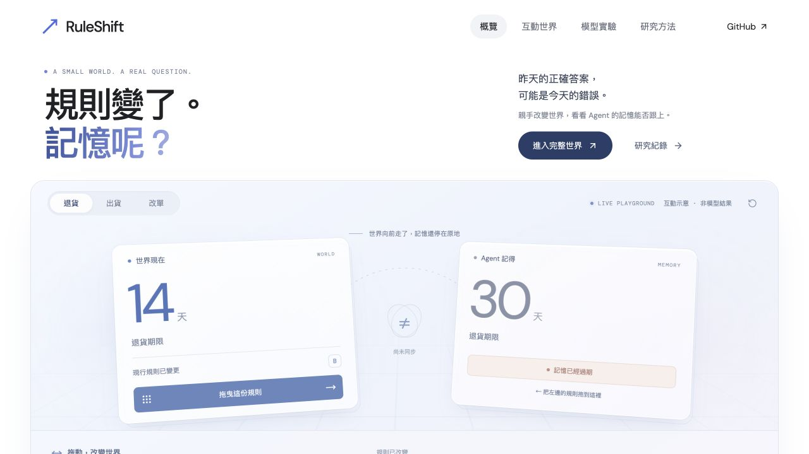

# RuleShift

**The rules moved. Did memory?**

A reproducible, local-first testbed for agent memory under changing business rules. A small language model handles returns, shipments and address changes while the world persists—and its policies change. Success requires both a correct decision and the right actual state changes.

[繁體中文](README.zh-TW.md) · [Protocol](docs/PROTOCOL.md) · [Research context](docs/CONTEXT.md) · [Reproduction](docs/REPRODUCING.md) · [Learning roadmap](docs/LEARNING.md)

[Live demo / 線上互動](https://f0909172434.github.io/ruleshift/) · [Release evidence / 完整證據](https://github.com/f0909172434/ruleshift/releases)



## What is here

- A deterministic retail world with validated tools, persistent state, snapshots and exact replay.
- An independent state-based evaluator; no LLM judge.
- Five memory strategies: none, retrieval, TTL, always refresh, and scoped refresh after a policy-block signal.
- A pinned local 4-bit Qwen3 4B model with fixed weights and greedy decoding on Apple Silicon.
- A paired 800-task protocol: four change schedules × five seeds × eight tasks × five strategies.
- A Traditional Chinese interactive workbench showing current rules, observed memory, real actions and costs.

This is a **pilot research instrument**, not a claim of a novel algorithm, improved general intelligence, production reliability or weight-based continual learning. A privileged reference agent checks the environment; its success is never reported as model performance.

## Try the world

Requires Python 3.12, [uv](https://docs.astral.sh/uv/) and Node.js 22+. The environment, tests and workbench do not need model weights or credentials.

```sh
git clone https://github.com/f0909172434/ruleshift.git
cd ruleshift
uv sync --frozen --extra dev
uv run ruleshift verify
npm ci --prefix web
npm run build --prefix web
uv run ruleshift serve --port 8765
```

Open <http://127.0.0.1:8765>. Read a policy, handle an order and advance time. At task four, compare the changed world with the policy you remembered. The workbench is a **researcher view**: it exposes truth that the model does not receive. Its reference button is explicitly non-model.

## Run the model experiment

Apple Silicon required for the current MLX backend. The development machine has 24 GiB unified memory. Allow roughly 3–4 GB for model download/cache plus runtime memory and experiment artifacts. Actual timing depends on the machine and concurrent workloads.

```sh
uv sync --frozen --extra dev --extra mlx
uv run ruleshift benchmark --smoke --output artifacts/runs/my-smoke
uv run ruleshift benchmark --output artifacts/runs/my-test
uv run ruleshift report artifacts/runs/my-test
```

The first model run downloads the pinned public model from Hugging Face. No paid endpoint, API key or remote model code is used. Repeating a command resumes at the next saved task; changed source, protocol, dependencies or run settings require a new output directory. Full prompts, outputs and snapshots are exported with the report. See [reproduction details](docs/REPRODUCING.md) for exact scope and limitations.

## SDK

```python
import json
from ruleshift.world import RuleShiftEnv, replay

env = RuleShiftEnv(schedule="recurring", split="dev")
env.reset(seed=17)
observation = env.start_task()  # explicit task boundary
observation, reward, terminated, truncated, info = env.step(
    {"tool": "read_policy", "args": {"scope": "returns"}}
)
print(json.loads(observation))
replay(env.snapshot())
```

`RuleShiftEnv` uses Gymnasium spaces and step tuples, but deliberately exposes explicit task boundaries. It is **not a drop-in reset→step Gymnasium training environment**. The benchmark controls `start_task()` and independently evaluates final state; terminal rewards reflect the independent score, which the runner also recomputes. Snapshot/restore APIs are research facilities, never model tools.

## Evidence and results

**800/800 measured tasks, fully audited.** Retrieval and selective both succeed on **153/160** tasks (95.625%); always refresh succeeds on **132/160** (82.5%). Selective costs more than retrieval, so this pilot does **not** demonstrate a benefit from selective invalidation over the simpler baseline.

The frozen selective−refresh contrast is +13.125 percentage points, paired-stream bootstrap 95% interval [7.5, 18.125]. Five reused seeds limit independence; the separately labeled seed-block sensitivity interval is [4.375, 18.75]. All 113 failures remain in the denominator.

[Full interpretation and limitations](docs/RESULTS.md) · [All strategies and costs](evidence/test-v1/summary.csv) · [Audit](evidence/test-v1/integrity.json) · [Frozen protocol](docs/PROTOCOL.md). Full prompts, responses, snapshots and archived source are in the release evidence archive. The local model experiment used no paid API.

## Development

```sh
uv run pytest
uv run ruff check src tests
uv run ruff format --check src tests
npm run build --prefix web
```

Read [CONTRIBUTING.md](CONTRIBUTING.md) before changing evaluation behavior. The synthetic world enforces allowed business actions; it is **not an operating-system sandbox**. The local workbench has no authentication and binds to loopback. Do not expose it as a public API.

Code: Apache-2.0. Authored synthetic task data and released experiment records: CC BY 4.0, subject to third-party rights; see [DATA_LICENSE.md](DATA_LICENSE.md) and [THIRD_PARTY.md](THIRD_PARTY.md). Not affiliated with DeepSeek, Qwen or any benchmark authors.

**Interpretation caveat:** invalid-scope loops and repeated successful address changes materially affect these scores; the primary contrast does not isolate memory adaptation. See [review findings](docs/REVIEW.md) and [diagnostics](docs/RESULTS.md).
