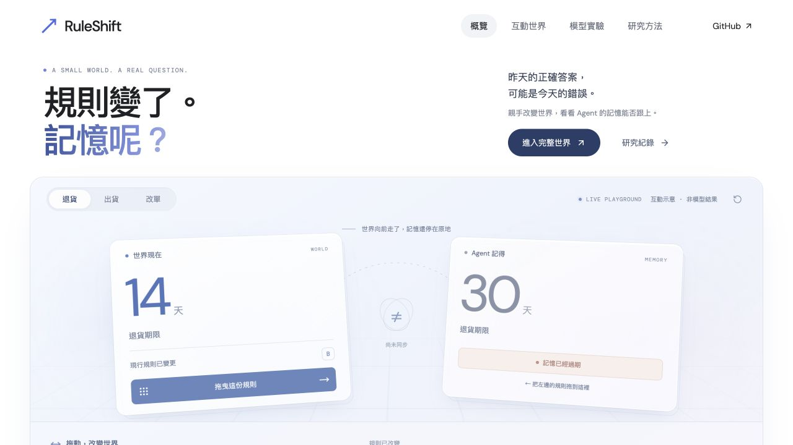

# RuleShift｜規則變了，記憶跟上了嗎？

RuleShift 是一個模擬零售世界，用來測試 Agent 的記憶能不能跟上業務規則的改變。模型要處理退貨、出貨與地址變更，每次操作都會留下真實狀態，而世界的規則會在任務之間改變。評分同時檢查兩件事：決定是否正確，以及事情是否真的完成。

[English](README.md) · [實驗協定](docs/PROTOCOL.md) · [職缺與研究定位](docs/CONTEXT.md) · [學習與延伸路線](docs/LEARNING.md)

這個專案包含三部分：一套可以驗證結果的 Agent 系統、一個對各策略公平的實驗設計，以及一個能看出失敗原因的互動介面。它不是包一層聊天機器人。參考解法拿到滿分，只代表任務可解，不代表模型的能力。

[Live demo / 線上互動](https://f0909172434.github.io/ruleshift/) · [Release evidence / 完整證據](https://github.com/f0909172434/ruleshift/releases)



## 目前具備什麼

- 三種任務、四種規則變動時程。訂單與庫存狀態會跨任務保留。
- 五種記憶策略，共用同一個固定權重的小模型、同一組工具與同樣的預算。
- 每一步都記錄提示、模型輸出、工具操作、成本與世界快照。
- 不靠另一個模型打分。結果由獨立規格檢查，並可重播驗證。
- 繁體中文工作台，並排呈現「當前世界」與「模型實際觀察過的記憶」。

首輪正式設計是 800 次任務執行。這是單一模型、合成零售世界的先導研究。即使 800 次全部跑完，也不足以推論真實產品的表現或一般智能。

## 啟動

先安裝 Python 3.12、uv 與 Node.js 22 以上，然後執行：

```sh
git clone https://github.com/f0909172434/ruleshift.git
cd ruleshift
uv sync --frozen --extra dev
npm ci --prefix web
npm run build --prefix web
uv run ruleshift serve --port 8765
```

打開 <http://127.0.0.1:8765>。先查詢規則、完成任務，再把時間推進到第四個任務，就能看到規則與記憶開始不一致。「參考解法」按鈕只用來檢查模擬環境，它的結果不代表 AI 的表現。

環境與介面不需要下載模型。真模型實驗目前使用 Apple Silicon 上的 MLX 後端：

```sh
uv sync --frozen --extra dev --extra mlx
uv run ruleshift benchmark --smoke --output artifacts/runs/my-smoke
uv run ruleshift benchmark --output artifacts/runs/my-test
```

第一次執行會下載固定版本的公開 Qwen3 4B 量化模型，過程中不使用付費 API。完整的安裝、續跑、證據格式與限制，請見 [REPRODUCING.md](docs/REPRODUCING.md)。

## 如何讓它成為自己的能力

第一步是親手重現一次模型失敗，並說清楚原因是舊規則、重複操作，還是錯誤結案。接著在開發集提出一個成本明確的新策略。策略凍結之後，另外建立一個沒看過的測試集，把成功與失敗都公開。能解釋一個負面結果，比只展示漂亮的成功案例更有說服力。

程式採 Apache-2.0 授權。自製的合成資料與發布的研究紀錄採 CC BY 4.0，第三方內容的權利另計。本專案與 DeepSeek 沒有隸屬關係。

## 正式測試結果

800 個任務全部完成並通過驗證，113 次失敗全數保留在分母中。

本輪要回答的是：選擇性更新能不能改善成功率與成本的取捨。沿用記憶與選擇性更新的成功數相同，都是 **153／160（95.625%）**；每次查證是 **132／160（82.5%）**。選擇性更新比沿用記憶多用 47 次工具呼叫、37 次查詢嘗試，卻沒有多成功任何一題。**這輪結果沒有證明新策略優於簡單方法。**

預先指定的比較是選擇性更新減每次查證，差值為 +13.125 個百分點。以 20 條配對任務串做 bootstrap，區間為 [7.5, 18.125]。同樣五個種子在各情境中重複使用，所以樣本之間並不獨立。另外附上以五個種子分組的敏感度分析，區間為 [4.375, 18.75]，它不取代原定結果。

[完整解讀與限制](docs/RESULTS.md) · [所有策略與成本](evidence/test-v1/summary.csv) · [完整性驗證](evidence/test-v1/integrity.json)

正式資料可以從 Release 下載後離線驗證。線上版提供可拖曳的教學示意與真模型回放，完整的世界操作則要用本機服務。

## 結果不能說明什麼

本輪分數明顯受到兩種行為影響：模型會陷入無效工具參數的迴圈，也會在地址已經改好之後重複修改。因此策略之間的差值，不能直接解讀成記憶適應能力。兩個模型的審查、修正內容與保留下來的限制，記錄在 [審查紀錄](docs/REVIEW.md) 和 [完整結果](docs/RESULTS.md)。
